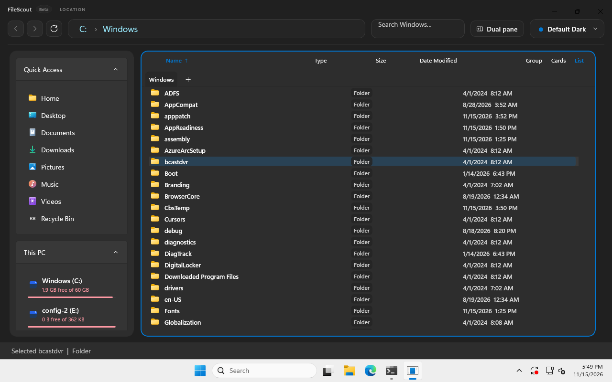
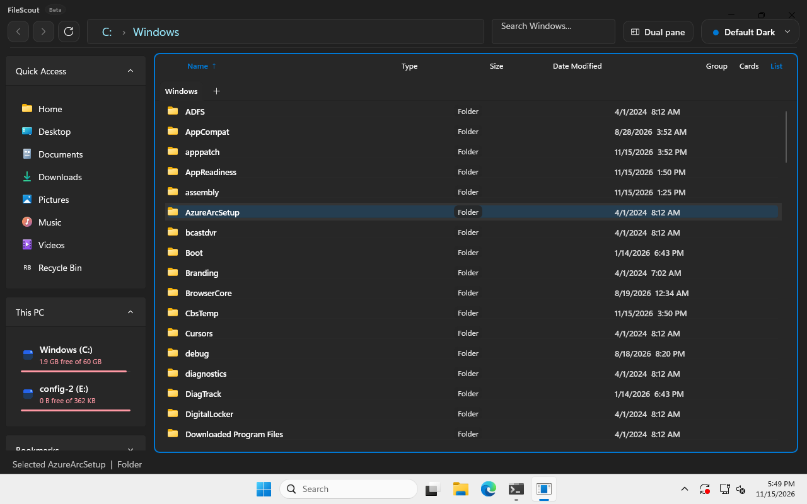
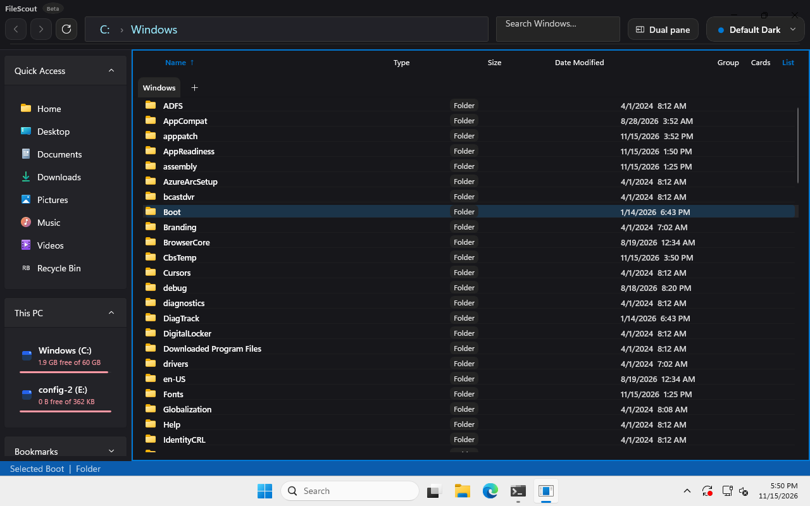
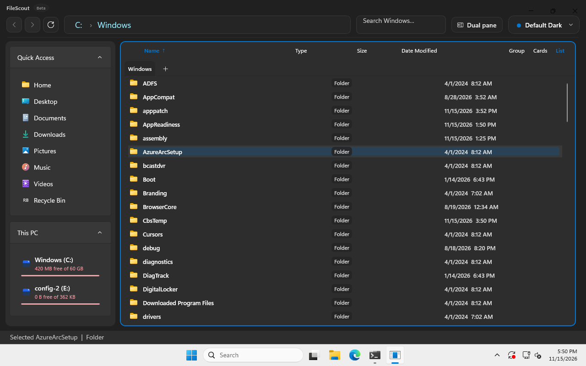
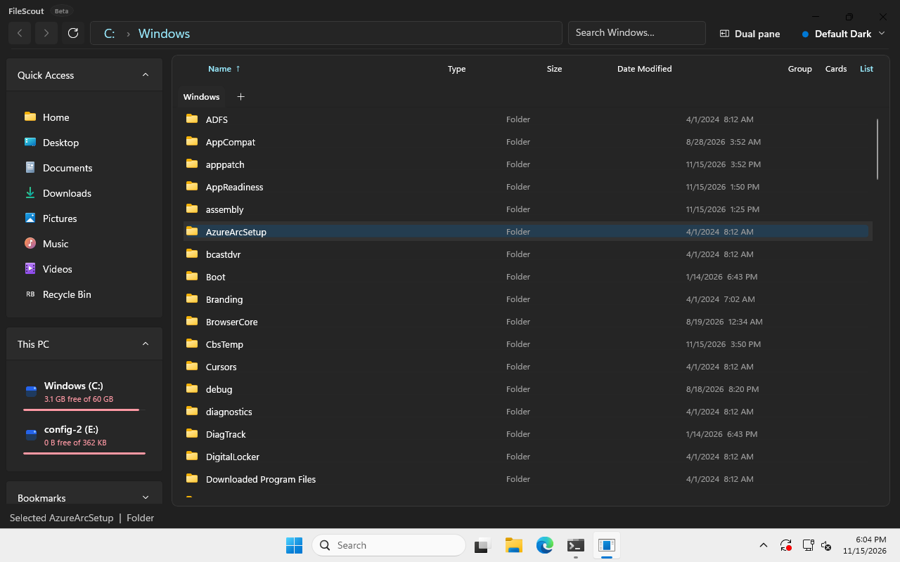
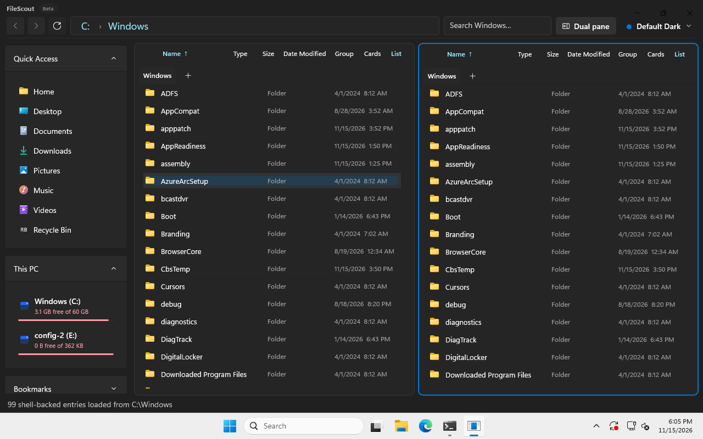

# New look: three prototypes, one choice

All screenshots were rendered on win1 (1280x800, 96 DPI, Microsoft Basic Display Adapter, so WARP).
Each shows the same folder (`C:\Windows`), with the window maximised and one row selected by a real
click. Mica cannot be seen under WARP: Windows draws its fallback solid colour, and a GPU machine
shows the wallpaper tint.

## Starting point

Problems in the current chrome, besides taste:
- The dead `LOCATION` label (UA-01).
- An empty status-icon slot (UA-02).
- The window is 1520x920 on a 1280x800 screen, so the caption buttons and the theme menu are off-screen.
- Nested cards (sidebar card > expander card > item tiles).
- A semibold font everywhere.
- A pill around each type label.
- A thick accent frame around the only pane.
- 40 px controls with 12 px corners.

## Prototypes

The prototypes were built from one build (`proto/looks` branch, `FILESCOUT_LOOK=a|b|c`). The script is
`tools/win1/demo/look-shots.ps1`.

| | |
|---|---|
| **A — Fluent native.** Explorer-like. No sidebar card, layer-fill panes with 8 px corners, 32 px controls with 4 px corners, transparent status bar, 32 px rows.  | **B — Dense pro.** Opaque graphite, hairline dividers, square corners, 24 px rows, accent status bar, as in power-user file managers.  |
| **C — Refined cards.** Today's card layout tightened: 10 px corners, neutral strokes, 30 px rows.  | |

## Choice: A, with B's quieter row typography

**Why A:**
- **It is a replacement for Explorer.** Someone who sets FileScout as the default file manager opens it from
  Win+E, desktop folders and browser downloads, next to other Windows 11 apps. A uses the same
  materials and proportions as Explorer: Mica or layer fills, 4 px controls, 32 px rows. It looks
  native and not like a themed island.
- **Only theme resources.** A follows light and dark mode and the user's accent with no extra work. B relies on
  hard-coded greys and an accent status bar, which break in light mode. They would also fail the
  existing "no colour islands" criterion (`docs/ai/archive/ui-polish/ui-polish-eval-criteria.md`) unless every
  colour became a token.
- **C keeps the nested cards that make the current UI busy.** It changes spacing, not structure.

**Taken from B:**
- Normal-weight names.
- Plain secondary-colour type, size and date columns, without pills.
- Right-aligned sizes.
- Only a hairline around the pane when it is the only one.

## Shipped

Bug-ledger items closed by this change:
- UA-01: `LOCATION` removed.
- UA-02: status icon slot removed.
- UA-08 / UB-13 (partly): `#0078D4` → `AccentTextFillColorPrimaryBrush` and `#C42B1C` → `SystemFillColorCriticalBrush`. A test now limits literal colours in `MainWindow.xaml` to the palette scrim.
- UA-14: the palette comment is now accurate (Ctrl+P, gate on).
- The window now fits the work area.

Not changed:
- The sidebar expanders keep their default WinUI expander chrome. Flattening them means rebuilding
  `BuildSidebarFavorites`, which builds that chrome in code; it is listed as open in the final report.
